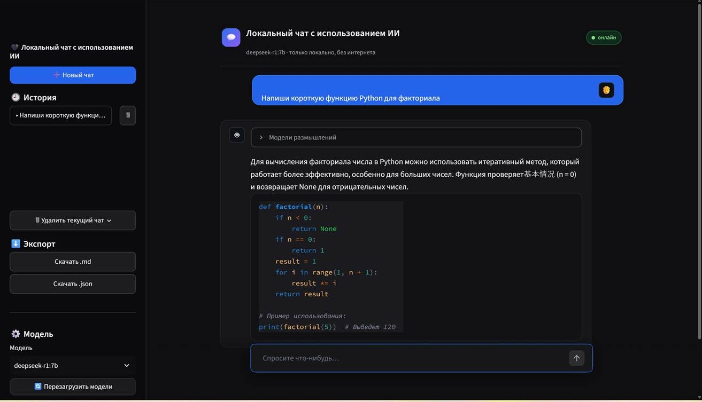

# Local AI Chat

**Локальный чат-интерфейс для Ollama в стиле ChatGPT.**
С локальным сервером Ollama генерация идёт на вашем компьютере. Для первоначальной установки и скачивания модели нужен интернет.

[](https://www.python.org/)
[](https://streamlit.io/)
[](https://ollama.com/)
[](LICENSE)

## Возможности

| | Возможность |
|---|---|
| 💬 | **Чат в стиле ChatGPT** — сообщения пользователя справа, ответы ассистента слева, поле ввода закреплено внизу |
| 🕘 | **История чатов** — каждый диалог сохраняется в `chats/*.json`; список в сайдбаре, загрузка по клику, удаление |
| 🧠 | **Размышления DeepSeek-R1** — блок `think` спрятан в раскрывающийся аккордеон |
| 📎 | **Контекст из файлов** — `.txt`, `.py`, `.md`, `.pdf`: текст извлекается и добавляется в системный промпт |
| ⬇️ | **Экспорт** — скачивание диалога в Markdown (с `<details>`) или JSON |
| 🎨 | **Подсветка кода** — блоки с тройными обратными кавычками рендерятся встроенным подсветчиком Streamlit с кнопкой копирования |
| 🌊 | **Стриминг** — ответ приходит по мере генерации, без ожидания целиком |
| 🔄 | **Горячая перезагрузка моделей** — кнопка обновляет список без перезапуска приложения |
| ⚙️ | **Настройки** — модель, температура, системный промпт, очистка контекста |

## Установка

### Вариант 1. Портативный runtime (Windows)

Для обоих вариантов установите [Ollama](https://ollama.com/download), запустите её и скачайте модель командой `ollama pull deepseek-r1:7b`.

`runtime/` собирается локально. Для сборки нужны Python 3.10+ и интернет. После сборки лаунчер использует Python из `runtime/`.

```bash
python setup_runtime.py
pip install --target runtime/Lib/site-packages -r requirements.txt
```

После этого чат запускается двойным щелчком по `run_local_ai_chat.bat` —
он сам поднимет Ollama (если она не запущена) и откроет браузер.

### Вариант 2. Свой Python

```bash
# 1. Зависимости
python -m venv .venv
.venv\Scripts\activate        # Windows
# source .venv/bin/activate   # macOS / Linux
pip install -r requirements.txt

# 2. Запуск
streamlit run app.py
```

Приложение откроется на <http://localhost:8501>.

## Интерфейс



## Как пользоваться

1. **Задайте вопрос** в поле внизу — `Enter` отправляет, `Shift+Enter` переносит строку.
2. **Новый чат** — кнопка «➕ Новый чат»; текущий диалог уже сохранён в `chats/`.
3. **Вернуться к прошлому чату** — клик по названию в разделе «🕘 История».
4. **Спросить по файлу** — приложите `.txt` / `.py` / `.md` / `.pdf` в сайдбаре и задайте вопрос;
   текст файла уходит в системный промпт (до 12 000 символов, лимит виден под списком файлов).
5. **Выгрузить диалог** — кнопки «Скачать .md» / «Скачать .json» в разделе «⬇️ Экспорт».

## Структура проекта

```
local_ai_chat/
├── app.py                  # всё приложение: UI, Ollama-клиент, история, контекст из файлов, экспорт
├── requirements.txt        # streamlit, requests, pypdf
├── .streamlit/config.toml  # тёмная тема, порт 8501, без телеметрии
├── chats/                  # история чатов (создаётся автоматически, в .gitignore)
├── logs/                   # логи Ollama и Streamlit
├── runtime/                # портативный Python + зависимости (в .gitignore)
├── open_chat.ps1           # ждёт сервер и открывает браузер
├── run_local_ai_chat.bat   # запуск: python → streamlit → браузер
└── setup_runtime.py        # пересоздание локального runtime с нуля
```

## Настройки

| Параметр | Где менять | По умолчанию |
|---|---|---|
| Адрес Ollama | переменная окружения `OLLAMA_URL` | `http://localhost:11434` |
| Модель по умолчанию | `OLLAMA_MODEL` или селектор в сайдбаре | `deepseek-r1:7b` |
| Температура | слайдер в сайдбаре | `0.7` |
| Контекст файлов | `MAX_CONTEXT_CHARS` в `app.py` | `12 000` символов |
| Окно модели при работе с файлами | `NUM_CTX` в `app.py` | `8192` токена |

## Если что-то не работает

| Симптом | Решение |
|---|---|
| «Ollama недоступен» | Запустите `ollama serve` или перезапустите ярлык |
| «Модель ещё не загружена» | `ollama pull deepseek-r1:7b` |
| Список моделей пуст | Кнопка «🔄 Перезагрузить модели» в сайдбаре |
| PDF не читается | Убедитесь, что `pypdf` установлен: `pip install -r requirements.txt` |
| Медленные ответы | 7B на CPU — нормально 20–60 с; на GPU Ollama ускорится сама |

Логи: `logs/streamlit.err.log`, `logs/ollama.err.log`.

## Участие

Issues и pull requests приветствуются. Перед PR запустите приложение локально и убедитесь,
что чат, история и загрузка файлов работают.

## Лицензия

Проект распространяется по лицензии [MIT](LICENSE).
